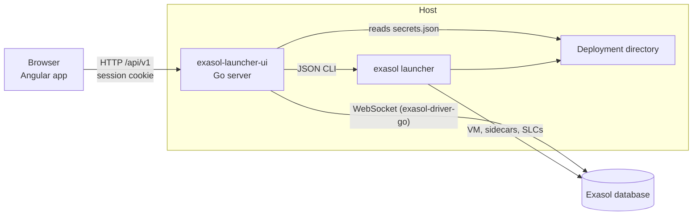

# Architecture

Exasol Launcher UI is one Go binary that serves an Angular application and a
narrow HTTP API on loopback. The API acts on local Exasol Personal deployments
in two ways: it runs the `exasol` launcher for everything the launcher owns
(deployments, lifecycle, configuration, sidecars, script languages,
diagnostics), and it connects to the database itself for SQL and imports.

The server runs on the host rather than as a launcher sidecar, because sidecar
management, lifecycle operations, and the deployment directory are only
reachable from the host.

## Startup

`cmd/exasol-launcher-ui/main.go` parses the flags (`--version` prints the
build-time `main.version` and exits), checks that the launcher
runs (`launcher.Client.Check`), binds `127.0.0.1:<port>`, creates the long-lived
managers (SQL sessions, uploads, imports, operations), and prints the access
URL with a fresh token. `server.NewGuard(...).Wrap(server.NewHandler(...))` is
the whole request pipeline: the guard checks every request, then the mux
routes `/api/v1/...` to the API and everything else to the web application.
Ctrl+C cancels the root context, which ends event streams, closes SQL
sessions, cancels imports, and removes uploads.

## Security model

The API acts with the deployment's administrative database credentials, so:

- The listener binds `127.0.0.1` only (`server.Listen`).
- `server.Guard` rejects requests whose `Host` is not `127.0.0.1:<port>` or
  `localhost:<port>` and whose `Origin`, when present, is not that server. This
  stops DNS rebinding and cross-site requests.
- The startup URL carries a random 256-bit token. The guard exchanges it for an
  HttpOnly, SameSite=Strict cookie named per port and redirects to the same
  path without the token. API requests without the cookie get 401, which the
  browser turns into the session-expired screen.
- Passwords stay on the server: `database.ReadPassword` reads them from the
  deployment's `secrets.json`, responses have no password fields, and
  `database.Redact` and the operations output filter remove them from errors
  and launcher output.

Keep these invariants in every new endpoint.

## Server packages

| Package | Responsibility |
| --- | --- |
| `cmd/exasol-launcher-ui` | Flags, startup, access URL, shutdown. |
| `internal/server` | Guard, mux, `/api/v1` handlers (one `*_api.go` per resource family), problem responses, serving the web application with an index fallback for client routes. |
| `internal/launcher` | The launcher's JSON CLI client. `launchertest` provides a fake launcher executable. |
| `internal/operations` | Long launcher commands run in the background, with progress lines, events, and outcome. |
| `internal/database` | `secrets.json`, connection targets, ping, password redaction. |
| `internal/sql` | SQL sessions, statements, cancellation, CSV exports, schema metadata. `sqltest` provides a fake database. |
| `internal/imports` | Parquet footer reading, Exasol's type inference, uploads, import suggestions, and imports. `importstest` writes Parquet fixtures. |
| `internal/opener` | Opens URLs and folders with the platform's opener. |
| `internal/webapp` | Embeds the Angular build from `internal/webapp/dist`. |

## HTTP API

All resources live under `/api/v1` and are shaped like the Administration API
in `../admin-ui/openapi/openapi.json`, so they can move there later:

- Deployments are addressed by name: `/api/v1/deployments/{name}/...`. Handlers
  resolve the name to a directory through the launcher's listing
  (`api.findDeployment`) and answer 404 for unknown names.
- JSON bodies use snake_case fields.
- Errors are RFC 9457 problem details (`writeProblem`). A launcher that
  refuses a short command returns a `launcher.LauncherError`; handlers answer
  it with 409 (or 400 for invalid input) and the launcher's message
  (`answerLauncherError`).
- Long actions (`start`, `stop`, `deploy`, `destroy`, `remove`, sidecar and
  script language changes) answer 202 with an operation and a `Location`
  header; a second operation on the same deployment answers 409.

| Resource family | File |
| --- | --- |
| Deployments, details, ping, open folder | `api.go` |
| Configuration (`GET`, `PATCH`, reset) | `configuration_api.go` |
| Lifecycle actions and `/operations` with an event stream | `operations_api.go` |
| Sidecars and MCP client instructions | `sidecars_api.go` |
| Script language containers | `script_languages_api.go` |
| Diagnostics (local runtime, info report, unlock) | `diagnostics_api.go` |
| SQL sessions, statements, cancel, exports | `sql_api.go` |
| Schemas and columns | `schemas_api.go` |
| Uploads, import suggestions, imports | `uploads_api.go`, `imports_api.go` |

The OpenSpec specs in `openspec/specs/` are the canonical description of each
endpoint's behavior.

## Launcher integration

`launcher.Client` is the only place that starts the launcher; keep new launcher
calls on it.

- Short commands (`deployments list`, `info`, `config get`, `sidecar status`,
  ...) run with `--json` through `runJSON`, one at a time. The launcher's
  directory lock breaks when two launchers start on one deployment at the same
  moment, leaving it locked with "invalid marker"
  ([exasol-personal#515](https://github.com/exasol/exasol-personal/issues/515)).
  To recover, delete the empty `.dirmutex.*` files while no launcher runs.
- The deployment listing is cached for 10 seconds; operations invalidate it
  when they finish, and `?refresh=true` bypasses it.
- Long commands run through `Stream`, which reports each stderr line. Without a
  terminal the launcher writes JSON log records to stderr; `Stream` turns them
  into readable lines.
- Cancelling interrupts the launcher (SIGINT) and kills it only after a grace
  period, so it can release its lock.

Launcher behavior that shapes the UI:

- Decide actions on the listing's `status`, which checks the runtime; `info`
  can report a stale stored `deploymentState`.
- `init`, `install`, `deploy`, and `destroy` have no `--json` output; judge
  them by exit status and stream their stderr.
- `config set --help` lists no preset options. The command accepts them as
  `--<option>` flags validated against the preset; `config get --json` reports
  them under `infrastructure.options` and `installation.options`.
- `config set` and `config reset` only work on initialized cloud deployments
  and stopped local deployments.

The launcher's contracts are specified in `../exasol-personal/openspec/specs/`.

## Operations

`operations.Manager` runs one long launcher command per deployment at a time.
An operation has a `Kind` (start, stop, deploy, enable_sidecar, ...), the
deployment, and `operations.Parameters` for what it acts on within the
deployment (a sidecar, a script language alias). It keeps the progress lines
(with the password removed), the outcome, and the error, and publishes events
that `GET /api/v1/operations/{id}/events` streams as server-sent events.
The last 50 finished operations stay listed so the browser can show their
outcome.

To add a long action: add a `Kind`, its launcher arguments in
`Kind.command`, an endpoint that calls `runOperationOn`, and its label in the
browser's `operation-labels.ts`.

## Database access

- `database.Target` is built from `exasol info --json` (host, port, user,
  certificate check) plus the password from `secrets.json`.
- Statements run through the driver's exported connection
  (`internal/sql/driver.go`), because `database/sql` loses row counts and the
  driver's own decoding turns numbers into `float64`.
- `sql.Manager` keeps one connection per SQL session, closes idle sessions
  after 30 minutes, and returns at most 10,000 rows per statement.
- Cancelling a statement runs `KILL STATEMENT IN SESSION` on a separate
  connection; cancelling the driver's context leaves the connection out of
  step.
- `imports.Manager` creates the table and runs `IMPORT ... FROM LOCAL PARQUET`
  for each uploaded file in one transaction. Uploads live under
  `$TMPDIR/exasol-launcher-ui/uploads`, expire after 24 hours, and are removed
  on shutdown.
- Health views will read `EXA_STATISTICS`, which local deployments populate at
  every granularity.

## Web application

`web/` is an Angular application that follows the Admin UI's conventions
(`../admin-ui/CLAUDE.md`): standalone components, NgXs state, SCSS with BEM,
Jest tests, and `@exasol/ui-common` for the layout and widgets.

| Path | Contents |
| --- | --- |
| `src/app/routes.ts` | Routes, the drawer entries (`APP_NAV_ITEMS`), and `DeploymentPage`, one route segment per page. |
| `src/app/shell/` | The deployment shell: layout, activity indicator, deployment selector, page outlet. |
| `src/app/pages/page-*` | One component per page (deployments tiles, overview, SQL, import, sidecars, MCP, script languages, settings, diagnostics). |
| `src/app/components/` | Reusable pieces such as the operation progress, danger dialog, SQL editor (CodeMirror), and results grid (AG Grid). |
| `src/app/store/<feature>/` | NgXs state and actions per feature; pages dispatch actions and select state. |
| `src/app/services/local-api/` | `LocalApiService` (all HTTP calls), the API models, and `OperationEventsService` for event streams. |
| `src/app/services/session/` | Detects 401s and shows the session-expired screen. |
| `src/app/sql/` | SQL editor helpers: dialect, completion, statement splitting, formatting, per-deployment storage. |
| `src/app/testing/` | API mocks for tests. |

The application polls `/api/v1/operations` (faster while one runs) so every
page sees running operations. The SQL page loads lazily to keep the initial
bundle under its budget in `angular.json`.

`task build` writes the production build to `internal/webapp/dist`, which the
Go binary embeds; `task dev` writes a development build to `web/.dev-dist` and
serves it with `--web-dir`.

## Testing

- Go handler tests drive `server.NewHandler` with the fake launcher from
  `launchertest`, which answers each argument list from files the test writes,
  and the fake database from `sqltest`.
- Tests against a real local deployment come in two kinds. The database ping
  test runs with `go test ./...` and skips when no deployment is ready
  (`go test -short ./...` always skips it). The SQL and import integration
  tests need `go test -tags integration ./...`.
- Check destructive operations on a scratch deployment from
  `exasol init local -d <name>`, which creates no VM, never on real ones.
- Web tests use Jest with the mocks in `src/app/testing`.

## Releases

Pushing a tag `v<major>.<minor>.<patch>` runs
`.github/workflows/release.yml`: it runs `task test`, then GoReleaser
(`.goreleaser.yaml`) builds the web application once, builds the five
platform binaries with `main.version` set to the tag without its `v`, and
publishes the archives, `checksums.txt`, and `scripts/install.sh` as a GitHub
release. A job then installs the release with its `install.sh` on Linux
x86_64, Linux arm64, and macOS and checks `--version`.

- A tag with a suffix, such as `v0.2.0-rc1`, publishes a pre-release, which
  `releases/latest` and therefore the install command skip. Test a release
  this way before tagging the final version.
- The install command fetches `install.sh` from the latest release, so
  installer changes reach users only with a release.
- To withdraw a broken release, delete the release and its tag on GitHub;
  `releases/latest` then refers to the previous release.
- CI runs `goreleaser check` and a snapshot release on every pull request.
  To run them locally, install [GoReleaser](https://goreleaser.com) and run
  `goreleaser release --snapshot --clean --skip=publish`; the archives land in
  `dist/`.

`scripts/install_test.go` tests the installer against a fake release server,
with `EXASOL_LAUNCHER_UI_DOWNLOAD_URL` pointing at it and a fake `uname`.

## Adding a feature

1. Draft the screens on the design canvas and agree on them.
2. Propose an OpenSpec change; specify behavior at the HTTP API or in the
   browser.
3. Server: add the launcher call to `internal/launcher` (with a fake-launcher
   test), the handler in a `*_api.go` file registered from `api.register`, and
   an operation kind if the command runs long.
4. Browser: add models and calls to `LocalApiService`, a store under
   `store/<feature>`, the page under `pages/`, and its route segment and drawer
   entry in `routes.ts`.
5. Update this document and [AGENTS.md](../AGENTS.md) where the change affects
   them.
